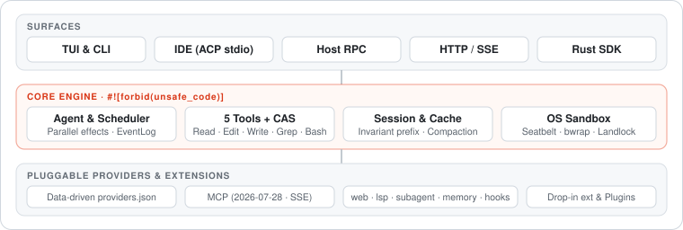

<p align="center">
  
</p>

<h1 align="center">Carnot</h1>

<p align="center">
  A fast, safe Rust coding-agent harness — maximum work, minimum wasted tokens.
</p>

<p align="center">
  <a href="#quick-start">Quick Start</a> ·
  <a href="#providers--configuration">Providers</a> ·
  <a href="#benchmarks">Benchmarks</a> ·
  <a href="#surfaces--extensions">Surfaces</a> ·
  <a href="#architecture">Architecture</a> ·
  <a href="SECURITY.md">Security</a>
</p>

<p align="center">
  
  
  
</p>

<br />

Carnot compiles to a single **15.7 MB** native binary (`#![forbid(unsafe_code)]`, all built-in extensions included) with a **7.4 ms** median startup to first HTTP request, **10.3 MiB** peak RSS, a **1,173-token** cross-directory invariant prompt prefix, and fail-closed OS sandboxing.

## Quick Start

```bash
# Build from source (TUI + all built-in extensions enabled by default)
cargo build --release --bin carnot

# Launch the interactive TUI (auto-detects your configured provider)
export ANTHROPIC_API_KEY=...
carnot

# Run a one-shot task (supports piped stdin & multimodal --image)
carnot -p "Fix the failing tests and summarize the root cause"
git diff | carnot -p "Review this diff" --image ui.png

# Resume the latest workspace session, or run as an IDE / RPC / HTTP server
carnot -c
carnot --mode acp
CARNOT_HTTP_TOKEN=secret carnot serve --addr 127.0.0.1:7744
```

> Standalone `carnot` enables `web`, `lsp`, `subagent`, and `memory` out of the box with zero static prefix-cache cost. Override with CLI flags (`--no-web`, `--profile minimal`, `--cache-ttl short|hybrid|long`) or run `carnot doctor` to inspect your environment.

## Highlights

- **Instant startup & tiny footprint** — `7.4 ms` median to first HTTP request and `10.3 MiB` peak RSS.
- **Provider-agnostic prompt-cache optimization** — byte-identical static prefix across workspaces (`carnot audit-prefix`), `CacheTtl` retention tiers (`short`, `hybrid`, `long` — with `5m`/`1h`/`24h` aliases), real `prefix_retention_rate` & runtime cache-break detection (`/cache`), smart subagent cache retention, and cache-warm semantic compaction.
- **5 surgical core tools** — `Read` (multimodal + tree-sitter outlines), `Edit` (atomic + fuzzy patch + CAS undo), `Write`, `.gitignore`-aware `Grep`, and `Bash` with BLAKE3 output shaping.
- **Fail-closed OS sandbox** — macOS Seatbelt and Linux `bwrap` with automatic Landlock (ABI v1–v6) fallback inside containers, plus in-process `.git` write protection.
- **21 zero-hardcode providers (+ offline `faux`) & full MCP** — driven purely by [`providers.json`](crates/carnot-ai/catalog/providers.json) with declarative multi-protocol `model_routes` and OAuth 2.0 (`carnot auth login`), plus MCP `2026-07-28`, `2025-11-25`, and legacy SSE.

## Providers & Configuration

All **21 built-in providers** (+ offline `faux` for CI) live strictly as data in [`providers.json`](crates/carnot-ai/catalog/providers.json) (overlayable via `~/.carnot/providers.json` or `--provider-config`):

- **Frontier & Multi-Protocol**: Anthropic (`claude-*`), OpenAI Completions & Stateless Responses (`gpt-5.4`, `o3`, `o4-mini`), Google Gemini & Cloud Code (`gemini-*`), **Grok / xAI** (`grok-4.7` Responses API with sticky `x-grok-conv-id` cache routing), **Muse / Meta** (`muse-wonder-1.0`, `muse-spark-1.3`, `muse-ember-1.0` on `api.meta.ai/v1`), **Mistral** (`mistral-large-4`, `magistral`, `devstral`, `codestral` with strict `alnum9` tool IDs & structured thinking), **OpenCode Zen** (`opencode`) & **OpenCode Go** (`opencode-go`) with automatic multi-protocol routing under `OPENCODE_API_KEY`.
- **Inference & Local**: OpenRouter (PKCE OAuth + `cache_control`), DeepSeek, Kimi/Moonshot, Qwen/DashScope, Groq, Fireworks, Together, Cerebras, Ollama, LM Studio, vLLM, and offline `faux` for CI.

Persist personal defaults in `~/.carnot/config.toml` (override path with `CARNOT_CONFIG`):

```toml
provider = "anthropic"
model = "claude-sonnet-5-5"
effort = "high"
cache_ttl = "hybrid" # short | hybrid | long
profile = "carnot"

[extensions]
web = true
lsp = true
subagent = true
memory = true
```

Useful CLI utilities: `carnot providers`, `carnot models --all`, `carnot models --resolve <spec>`, `carnot auth login|status|refresh|logout`, `carnot mcp list|inspect`, `carnot modules`, `carnot audit-prefix`, `carnot doctor`.

## Benchmarks

<picture>
  <source media="(prefers-color-scheme: dark)" srcset="assets/benchmarks-dark.svg" />
  <source media="(prefers-color-scheme: light)" srcset="assets/benchmarks-light.svg" />
  
</picture>

<br />

| Benchmark | Result | Source |
| :--- | :--- | :--- |
| **Cold start / RAM / Binary** | `7.4 ms` · `10.3 MiB` RSS · `15.7 MB` (`all-ext`) · `1,173 tok` static prefix | [`harness_overhead.json`](benchmarks/harness_overhead.json) |
| **Terminal-Bench 4** (`Opus 5.5`, `max`) | `63.2%` (`24/38` valid tasks on a 41-task subset; `58.5%` incl. 3 refusals), `97.6%` cache hit, `100%` first-try `Edit`, `-18.5%` cost vs Claude Code | [`terminal_bench_4.json`](benchmarks/terminal_bench_4.json) |
| **Cache-Warm Compaction A/B** | `14/14` recall (0 amnesia), `-66.7%` post-compaction cost, `22.5×` context compression | [`compaction_ab.json`](benchmarks/compaction_ab.json) |

<details>
<summary>Full harness comparison &amp; compaction breakdown</summary>

#### Harness Overhead (15 runs + 3 warmups · Darwin arm64)

| Harness | Startup (med) | Peak RSS | Binary | Static Prefix | Cross-CWD Inv. |
| :--- | ---: | ---: | ---: | ---: | :---: |
| **Carnot (Rust)** | **7.4 ms** | **10.3 MiB** | **15.7 MB** | **1 173 tok** | **Yes** |
| Unharnessed (Rust) | 7.6 ms | 81.7 MiB | 26.8 MB | 1 035 tok | No |
| Codex CLI | 41.4 ms | 133.7 MiB | 284.4 MB | 9 730 tok | No |
| Claude Code | 249.9 ms | 216.0 MiB | 343.6 MB | 19 210 tok | No |
| Pi (Node) | 462.5 ms | 159.4 MiB | 238.1 MB | 1 399 tok | No |
| OpenCode (Bun) | 545.9 ms | 528.7 MiB | 215.3 MB | 9 644 tok | No |

#### Two-Tier Cache-Warm Compaction A/B (`claude-sonnet-5-5`, 4-phase resumed session)

| Metric | No Compaction | Carnot Compaction | Delta |
| :--- | ---: | ---: | ---: |
| Verification score | `14 / 14` | **`14 / 14`** | `0 amnesia` |
| Total net cost | `$0.7475` | **`$0.5593`** | **`-25.2%`** |
| Post-compaction cost (Phases 2–4) | `$0.2196` | **`$0.0732`** | **`-66.7%`** |
| Context size | `74,112` peak | **`68,775 → 3,059`** | **`-95.6%`** |

</details>

## Surfaces & Extensions

| Surface | How to use | Notes |
| :--- | :--- | :--- |
| **Terminal TUI / REPL** | `carnot` (or `carnot --plain`) | Streaming Markdown, live mid-turn steer (`Enter`) & follow-up (`Alt+Enter`), `^P` model picker, `/context`, `/cache`, `/fleet`, `/fork`, `/undo`, interactive approvals & `AskUser` |
| **IDE (ACP stdio)** | `carnot --mode acp` | Multi-session multimodal Agent Client Protocol with live model, effort & `cache_ttl` config options |
| **Host RPC & Python SDK** | `carnot --mode rpc` ([`sdk/python`](sdk/python/carnot_sdk.py)) | Bidirectional JSON-RPC (`--host-extension` for dynamic tools/gates/hooks) + zero-dep async Python client |
| **HTTP / SSE & TS SDK** | `carnot serve` ([`sdk/ts`](sdk/ts/src/index.ts)) | Bearer-authenticated REST + SSE with `Last-Event-ID` replay, `/v1/metrics` breakdown & `/v1/cache-ttl` |
| **Rust SDK** | `carnot::CarnotBuilder` | Embed directly in Rust apps with custom `Arc<dyn Module>` and `Arc<dyn Tool>` |

**Extensions** come in two zero-prefix-bloat tiers:

- **Built-in Rust extensions** (enabled by default in `carnot-cli`, opt-in via `--features all-ext` on library crate `carnot`): `web` (native + local search/fetch), `lsp` (warm diagnostics + `LspQuery`), `subagent` (isolated worktree delegation), `memory` (BM25 cross-session memory), `hooks` (Claude Code compatible), and `claude-plugins`.
- **Drop-in file extensions**: place any executable script or binary in `~/.carnot/extensions/` or pass `--ext ./my_ext.py` (speaks `carnot-ext/1` JSON-RPC; Python helper in [`sdk/python/carnot_sdk.py`](sdk/python/carnot_sdk.py)).

## Architecture

<picture>
  <source media="(prefers-color-scheme: dark)" srcset="assets/architecture-dark.svg" />
  <source media="(prefers-color-scheme: light)" srcset="assets/architecture-light.svg" />
  
</picture>

<details>
<summary>Workspace crate map (13 workspace crates + 6 extensions)</summary>

| Crate | Role |
| :--- | :--- |
| `carnot-cli` | Thin CLI binary, plain REPL, `doctor`, `audit-prefix`, `models`, `providers`, `auth`, `mcp`, `modules` (optional `tui` feature) |
| `carnot-tui` | Optional interactive full-screen Ratatui TUI (`state`, `commands`, `input`, `render`, `markdown`, `editor`, `theme`) |
| `carnot` | Ergonomic Rust SDK facade (`CarnotBuilder`) |
| `carnot-protocol` | ACP stdio, Host RPC stdio, HTTP/SSE server, interaction brokers |
| `carnot-agent` | Async turn loop, effect-parallel scheduler, lossless `EventLog`, compaction |
| `carnot-ext` | Core modules (`ExecMicroSkills`, `PrefixGuard`, `PolicyGuard`, `AskUser`) & drop-in host |
| `carnot-mcp` | MCP `2026-07-28` / `2025-11-25` / legacy SSE client with lazy schema caching |
| `carnot-tools` | `Read`, `Edit`, `Write`, `Grep`, `Bash`, optional tree-sitter outlines & `ReadTracker` |
| `carnot-ai` | Data-driven `ProviderRegistry`, wire adapters, `model_routes`, OAuth, retry & `webpki` TLS |
| `carnot-session` | Crash-safe branching JSONL v2 journal & canonical prefix hashing |
| `carnot-sandbox` | Fail-closed macOS Seatbelt, Linux `bwrap`, and safe Linux Landlock fallback |
| `carnot-cas` | Zero-I/O BLAKE3 content store with pre-spill secret redaction & semantic compressors |
| `carnot-core` | Leaf types (`Message`, `ToolEffects`, `Usage`, `SessionMetrics`, `ContextBreakdown`, `CarnotConfig`) |

</details>

## Security

See [`SECURITY.md`](SECURITY.md) for the full threat model: fail-closed OS sandboxing, filesystem confinement, `.git` write protection, pre-spill secret redaction, SSRF protection, and workspace trust boundaries.

## Development & Contributing

See [`CONTRIBUTING.md`](CONTRIBUTING.md). All PRs must pass:

```bash
cargo fmt --all -- --check
cargo clippy --workspace --all-targets --all-features -- -D warnings
RUSTDOCFLAGS="-D warnings" cargo doc --workspace --no-deps --all-features --lib
cargo test --workspace --all-features
```

## License

Dual-licensed under [Apache-2.0](LICENSE-APACHE) or [MIT](LICENSE-MIT) at your option.
